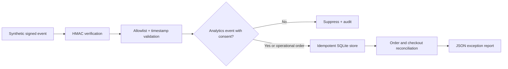

# E-commerce Event Reconciliation

**Independent portfolio demonstration** | Python / SQL / signed event validation / consent-aware ingestion / reconciliation

This is a small but fully runnable proof of work inspired by common ecommerce data-engineering problems. **It is an independent synthetic demonstration, not commissioned by or endorsed by a real business or platform provider.** No production services, customer records, or company-owned code are used.

## Why this exists

A commerce order can appear in different systems: operational checkout, marketing events, and downstream reporting. When retries create duplicates or one event records a different amount, dashboards can silently disagree with accounting. This project shows one controlled way to verify incoming events, reject unexpected payloads, preserve one canonical record per event, and report discrepancies.



## Run it (Python 3.10+, no dependencies required)

From this repository's root:

```bash
PYTHONPATH=src python -m ecommerce_reconciliation.cli demo
PYTHONPATH=src python -m unittest discover -s tests -v
```

On Windows PowerShell:

```powershell
$env:PYTHONPATH = 'src'
python -m ecommerce_reconciliation.cli demo
python -m unittest discover -s tests -v
```

The demo writes `output/reconciliation.json`. It produces four meaningful outcomes: matched order; a mismatched amount; an order missing a consented checkout event; and a duplicate replay. **No real customer information is involved.**

## Implemented features

| Concern | Demonstration |
| --- | --- |
| Authenticity | HMAC SHA-256 signature verified against original bytes |
| Input safety | Strict schema, ISO timestamps, size cap, no surprise fields |
| Idempotency | Event ID uniqueness plus canonical content-hash comparison |
| Consent | Browser analytics with `analytics_consent=false` never persisted |
| Audit | Ingestion outcomes recorded without raw customer payloads |
| Reconciliation | Compare latest paid operational orders with checkout events |
| Validation | Unit tests for replay, tampering, consent, mismatches, timestamps, persistence |
| Warehouse design | BigQuery SQL and example dbt staging files (illustrative only) |

## Project structure

```text
src/ecommerce_reconciliation/  # signed ingestion, SQLite state and CLI
tests/                         # offline unit tests
examples/                      # fictional JSONL events
sql/                           # proposed BigQuery adaptation
dbt/                           # example dbt models, not run on live BigQuery
docs/                          # security and production deployment boundary
```

## Key engineering decisions

1. **Small surface area.** The demo uses a deliberately restricted event schema rather than accepting arbitrary Shopify JSON. Real Shopify payload mapping is follow-up integration work.
2. **Separate operational and behavioral purposes.** Operational order events may enter without analytics consent; checkout events require affirmative consent before storage. Production purpose limitation requires legal review.
3. **No silent overwrite.** Identical retried event IDs are idempotent; conflicting event IDs are rejected.
4. **Document the unknowns.** BigQuery, GCP IAM, Cloud Run, dbt runtime behavior, monitoring, and source semantics must be verified before a production deployment.

Read [Security and deployment considerations](docs/security-and-deployment.md) for the actual gap to a production Cloud Run/BigQuery implementation.

## Possible paid engagement scope

A two-week first assignment could cover verified source-event mapping, consent/identity rules, a robust ingestion contract, replay tests, and an exception/reconciliation report. The exact scope and hours should be agreed after review of the company's real architecture.

**Author:** Ysmael A. Cailon | [GitHub profile](https://github.com/ycailon)
